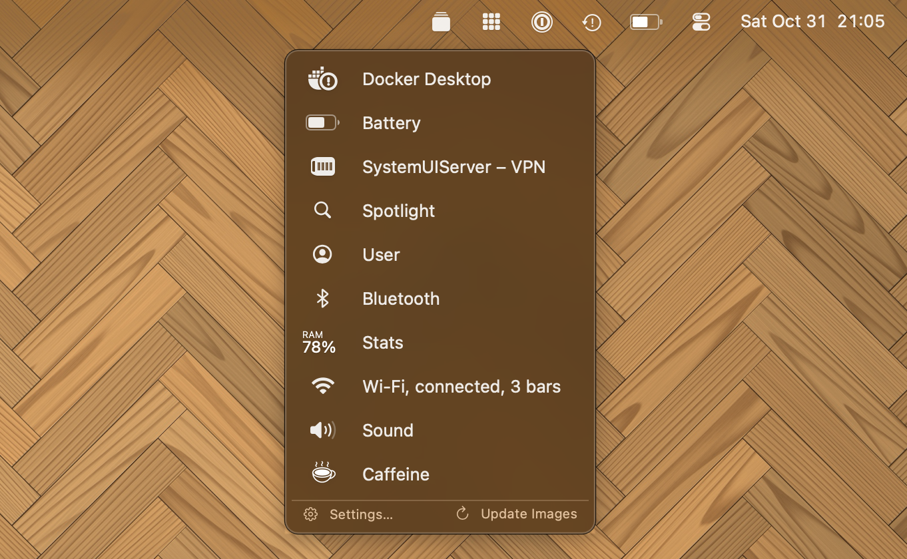
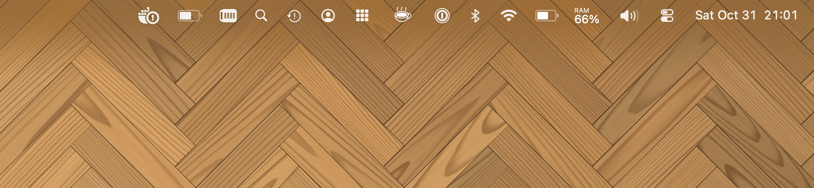
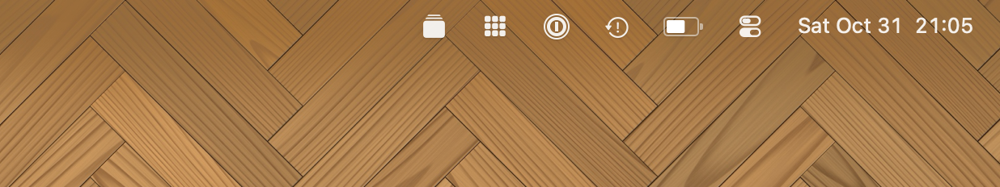
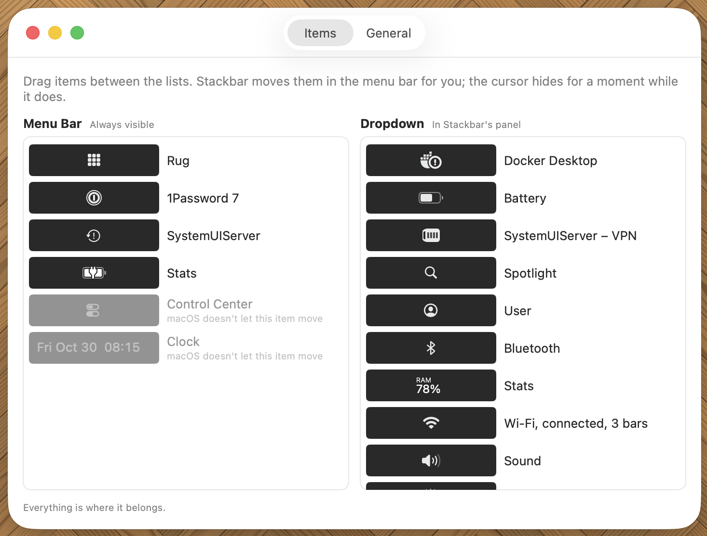
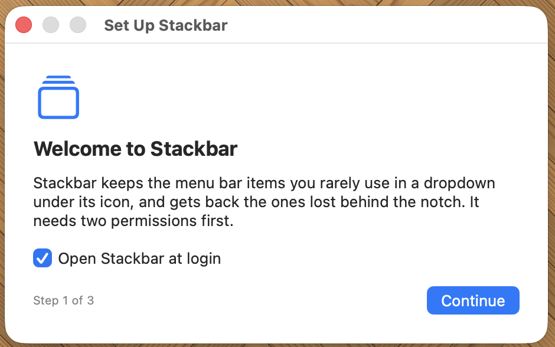

# Stackbar: hide menu bar icons on your Mac

**Stackbar is a free, open-source menu bar manager for macOS.** It tucks the menu bar icons you
rarely use into a tidy dropdown under one icon, and it gets back the icons a MacBook's notch hides.
No account, no tracking, no subscription.

<!-- screenshot:  -->

## Why Stackbar

- **A clean menu bar.** Every app wants an icon up there. Keep the few you use all the time and
  put the rest in Stackbar's dropdown, one click away.
- **Nothing lost behind the notch.** On a MacBook with a notch, macOS hides the icons that
  don't fit, and you can't reach them. Stackbar lists them in its dropdown so they're usable again.
- **Icons keep working.** Clicking an item in the dropdown opens its menu or popover right where it
  belongs in the menu bar, just like clicking the real icon.
- **Set it up once.** Stackbar remembers where you put each icon and puts it back when an app
  restarts or a new version moves it.
- **Free and private.** Open source under the MIT license. Stackbar doesn't collect anything; the
  only thing it contacts is GitHub, to check for updates.

<!-- screenshot:
| Before | After |
|---|---|
|  |  |
-->

## Features

- Dropdown with your hidden menu bar items, each with its icon and name
- Drag items between **Menu Bar** and **Dropdown** in Settings; Stackbar moves them for you
- Rescues icons hidden behind the MacBook notch
- **Show All Items** puts everything back in the menu bar for a moment, and it can collapse
  again by itself after 10 seconds to 5 minutes
- A keyboard shortcut to open the dropdown from anywhere
- Open at login
- Automatic updates from GitHub, installed in place (permissions stay granted)
- Works on Apple silicon and Intel Macs with macOS 26 Tahoe

<!-- screenshot:  -->

## Install

1. Download **Stackbar-X.Y.Z.dmg** from the
   [latest release](https://github.com/Sebas1337/stackbar/releases/latest), open it and drag
   Stackbar into Applications.
2. Open Stackbar from Applications. Stackbar isn't from Apple's developer program, so the first
   time macOS says it can't verify it. Click **Done**, then go to System Settings → Privacy &
   Security, scroll down to "Stackbar was blocked" and click **Open Anyway**. You only do this
   once: updates installed by Stackbar itself open normally.
3. Setup walks you through the rest: open at login, then the two permissions Stackbar needs.

<!-- screenshot:  -->

## How to use Stackbar

- **Click** the Stackbar icon to open the dropdown. Click an item there to open its menu.
- **Right-click** the icon for Show All Items / Collapse Menu Bar, Settings, macOS Menu Bar
  Settings, Check for Updates and Quit.
- **Choose what goes where** in Settings: drag items from the Menu Bar list into the Dropdown list
  (or back). Stackbar moves them in the menu bar for you; the cursor hides for a second while it
  does.
- **Remove an icon completely**: many items can be turned off in System Settings → Menu Bar
  (right-click the Stackbar icon → macOS Menu Bar Settings…). Stackbar sorts the items that are
  left.
- **Keyboard shortcut and auto-collapse**: Settings → General.

## Permissions and privacy

Stackbar needs two permissions, and it explains each one during setup:

- **Accessibility**: to find out which app each menu bar item belongs to, open their menus from
  the dropdown and move items between the menu bar and the dropdown.
- **Screen Recording**: to show pictures of the items in the dropdown. Stackbar only captures
  menu bar items: never windows, documents, the rest of your screen or audio. The pictures stay
  on your Mac.

Stackbar has no analytics and no account. Its only network request is the daily update check
against [GitHub Releases](https://github.com/Sebas1337/stackbar/releases), which you can turn off
in Settings → General.

## FAQ

**Why does macOS ask whether Stackbar may "bypass the system private window picker"?**
macOS asks this of every app that captures the screen without making you pick a window by hand.
Stackbar captures its menu bar items that way. Click **Allow**; macOS asks again about once a
month. If you don't allow it, the dropdown shows app icons instead of the items' pictures.

**Why do I have to click "Open Anyway"?**
Stackbar is signed with its own certificate, not one from Apple's paid developer program, so
macOS asks you once to confirm that you want to open it. Updates are signed with the same
certificate and open without asking.

**Which Macs does Stackbar run on?**
Macs with macOS 26 Tahoe, with Apple silicon or Intel. It's most useful on MacBooks with a notch,
but it tidies any menu bar.

**Some items can't be moved.**
macOS doesn't let apps move the Clock and Control Center. They always stay in the menu bar.

**How do I uninstall Stackbar?**
Quit Stackbar (right-click its icon → Quit Stackbar) and drag it from Applications to the Trash.
Its settings are in `~/Library/Application Support/io.github.sebas1337.stackbar`. You can also
remove it from System Settings → Privacy & Security → Accessibility and Screen Recording.

**Found a bug or have an idea?**
Open an [issue on GitHub](https://github.com/Sebas1337/stackbar/issues).

## License

Stackbar is free software under the [MIT license](LICENSE). What changed in each version:
[CHANGELOG.md](CHANGELOG.md). Building Stackbar yourself: [docs/DEVELOPMENT.md](docs/DEVELOPMENT.md).
